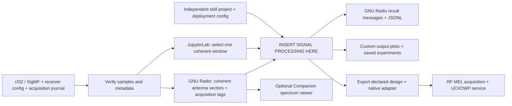
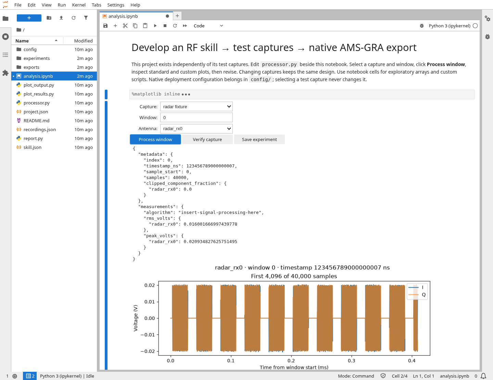
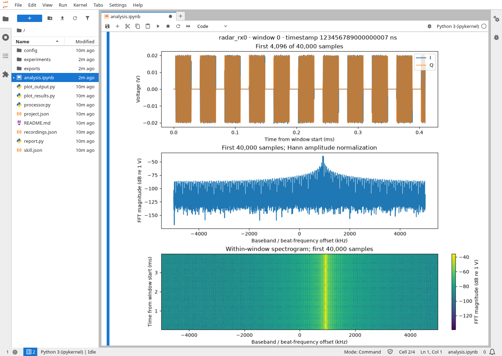
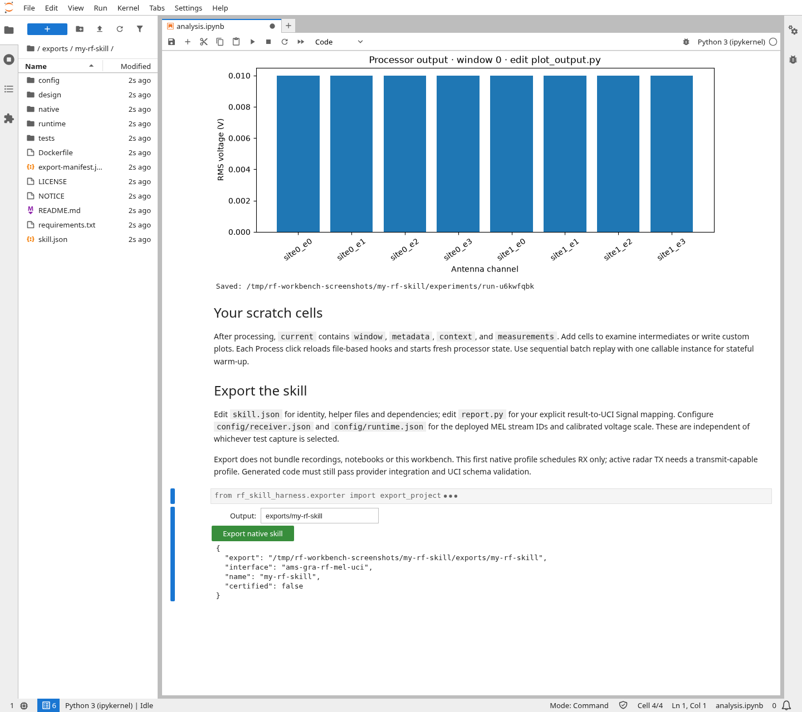

# RF Skill Harness

Create an independent RF skill project, develop it against selectable I/Q test
captures, then **export a native AMS-GRA RF MEL/UCI receive skill**. Iterate **edit →
process a block → plot → revise** in **JupyterLab**. Use **GNU Radio Companion
3.10** for graphical block development and GNU Radio for repeatable batch replay.
It works on CPU and has no AirSim, Sionna, GPU or detector dependency.



## Workbench in action

Live JupyterLab screenshots using the bundled **synthetic I/Q fixtures** and the
voltage-statistics starter. Notebook code inputs are collapsed for readability.

**Select a capture and window, process it, and inspect the measurements.**



<details>
<summary>See the I/Q diagnostics and native skill export</summary>

**Inspect complex voltage, FFT magnitude and the within-window spectrogram.**



**Save an experiment and export the receive skill.** The eight-channel RMS plot
comes from the starter processor; the file browser shows the generated package.
The export shown uses fixture-only deployment settings.



</details>

[Screenshot setup and reproduction](docs/images/README.md).

## Which interface fits?

| Interface | Best use here | Fit for the development loop |
| --- | --- | --- |
| **[JupyterLab](https://jupyterlab.readthedocs.io/en/stable/user/notebook.html)** + **[Matplotlib/ipympl](https://matplotlib.org/ipympl/)** | Edit code, select a finite block, inspect arrays, plot custom algorithm outputs, rerun cells. | **Recommended starting point.** A prepared notebook uses the same `processor.py` as batch replay. |
| **[GNU Radio Companion](https://wiki.gnuradio.org/index.php/GNURadioCompanion)** | Connect DSP blocks and standard Qt time, spectrum, waterfall or constellation sinks; write Embedded Python Blocks. | Best when developing a GNU Radio flowgraph or streaming integration. Our prepared viewer initially displays the input spectrum; custom skill results need your own visualization. |
| **[IQEngine](https://github.com/IQEngine/IQEngine)** | Browser-based SigMF spectrogram exploration, annotations and backend DSP plugins. | Useful for browsing/sharing captures. Integrating its plugin backend with our coherent multi-channel acquisition contract is additional work; not part of this harness. |
| **[inspectrum](https://github.com/miek/inspectrum)** | Inspect recorded I/Q visually and measure signal timing, bandwidth and modulation. | Useful input inspection; not the main workspace for editing and plotting an arbitrary RF skill. |

JupyterLab executes the Python hook directly; it does not run the GNU Radio
scheduler. The CLI additionally exercises stream tags, coherent window reassembly
and backpressure. Both use the original receiver data and the same hook contract.

## Launch the workbench—no capture or clone required

The skill project comes first. I/Q recordings are replaceable test fixtures,
not the definition of a skill. Linux, Docker, host Python 3.10+ and curl are
needed by the launcher; DSP, JupyterLab and plotting run in the CPU container.

```bash
curl -fsSL https://raw.githubusercontent.com/wa200508/RF-Skill-Harness/main/scripts/start_workbench.sh \
  -o start_workbench.sh
bash start_workbench.sh --workspace "$PWD/my-rf-skill" --name my-rf-skill
```

The launcher pulls/verifies the public image, downloads launcher code pinned to
that image's source revision, creates an independent project if the workspace
is empty, and starts the browser service. It honors the active Python virtual
environment or `RF_HARNESS_PYTHON`. Rootless Docker UID mapping is automatic.

Open **http://127.0.0.1:8888/lab** with Jupyter's printed token. Open
`analysis.ipynb` and Run All to show the capture selector, processing controls and
export button. With no captures supplied, the workspace still opens normally.

When test data is available, restart the **same project** with one or more capture
locations. A location can be one `iq/` directory, a mission containing `iq/`, or
a directory of recorded runs:

```bash
bash start_workbench.sh --workspace "$PWD/my-rf-skill" \
  --recordings /path/to/capture-library \
  --recordings /path/to/another-run/iq
```

Only receiver I/Q directories are mounted read-only by this launcher; adjacent
mission truth, camera and source telemetry directories are not mounted. Capture
selection and verification happen in the workbench. The recording is never
copied into the skill project. `recordings.json` provides local capture paths
for native Python users; container mount paths are supplied per lab session.

1. Select a capture, acquisition window and display antenna. All coherent
   antenna channels reach the processor; the antenna choice affects only plots.
2. Edit `processor.py`, save, then click **Process window**. Source reloads on
   every click. Use **Verify capture** to check the full recording's sample hashes.
3. Edit `plot_output.py` or add notebook cells for custom maps and intermediate
   arrays. Standard voltage, FFT and spectrogram plots inspect the input.
4. Save an experiment to `my-rf-skill/experiments/run-*/` when desired.
5. Set deployment configuration and UCI result mapping, then **Export native skill**.

`current` in the notebook exposes the selected window, metadata, context and
measurements for custom scripts. Single-window processing starts fresh hook
state; use sequential replay for algorithms requiring warm-up. The spectrogram
is not automatically a radar range–Doppler map. Your DSP interprets ADC gates.

Ctrl+C stops and removes the lab container; project files persist on the host.
Use `--port 8889` for a second workbench. Ports bind to host loopback, including
rootless Docker. For a remote host: `ssh -L 8888:127.0.0.1:8888 user@host`.

From a checkout, the equivalent launcher is
`bash scripts/run_harness.sh lab --workspace ./my-rf-skill --recordings /path/to/iq`.
`init --name my-rf-skill --output ./my-rf-skill` creates a project without starting
Jupyter. The old capture-bound `prepare` command remains for Companion graphs
and existing workspaces; it is not the normal skill-creation workflow.

## Export a native AMS-GRA RF skill

The exported skill runs the **same declared Python DSP files** behind a C++ RF MEL
host. It loads a real provider through `createAdminMEL`, `createC2MEL` and
`createDataMEL`, requests a Virtual Aperture and receive jobs, consumes
`ProductRxEndpoint` callbacks, and publishes UCI `SignalReport` / `ServiceStatus`
through OWP. It does not use our project-specific receiver TCP interface.

Before exporting, edit these project files:

| File | What belongs there |
| --- | --- |
| `processor.py` | Your tested, source-independent signal processing. |
| `report.py` | Explicit mapping from algorithm measurements to UCI Signal entries. Empty means no reportable detections; no detections are invented from the starter's RMS statistics. |
| `skill.json` | Identity, declared helper/model files, Python dependencies, processor/reporter entrypoints and capabilities. |
| `config/receiver.json` | Deployed receiver/antenna calibration and acquisition configuration. Selecting a test capture never changes it. |
| `config/runtime.json` | MEL stream IDs mapped to antenna channels, calibrated **volts per signed integer count**, processing/event sizes, OWP identity/topics and reporting rates. Unknown voltage calibration blocks export. |
| `config/rf_mel_registry.json` | Provider shared-library and provider configuration paths. |

Use the notebook export button or the container command:

```bash
bash scripts/run_harness.sh export ./my-rf-skill --output ./exports/my-rf-skill
cd exports/my-rf-skill
docker build -t my-rf-skill:local .
# Then run with the deployed provider, configuration and starter-kit network;
# the exported README gives the deployment command.
```

Exports include a Dockerfile, the unchanged declared design files, native adapter,
pinned upstream dependency revisions, configuration, notices and source hashes.
They exclude test captures, notebooks, experiments and the harness runtime. The
production image needs no Jupyter, GNU Radio, AirSim or Sionna installation.
Only file-based DSP hooks are exported; arbitrary edits to a replay `.grc` graph
are not automatically translated into a deployable skill.

**The initial native profile implements receive jobs.** It supports coherent
channels when callbacks identify one configured native stream per buffer.
Ambiguous packed streams, sample gaps, rate changes and queue overruns fail
explicitly. It does not generate active radar transmit jobs; a transmit-capable
profile is required before exporting that functionality.

**An export is not a conformance certificate.** The manifest records provider
integration and UCI schema validation as not run. Validate against your deployed
MEL provider, hardware calibration, UCI schema and OWP authorization before
claiming AMS-GRA compliance. Native fixture qualification and its limits are
covered in [the export guide](docs/native-export.md).

Reference contracts: [RF FM Demod](https://gitlab.com/open-arsenal/ams-gra/hello-world-sk/skills/rf-fm-demod),
[external interfaces](https://gitlab.com/open-arsenal/ams-gra/hello-world-sk/skills/rf-fm-demod/-/blob/74f9b2d5b59da44198ea092289a0d487afac10ac/docs/contracts.md),
and [RF MEL IDD interfaces](https://gitlab.com/open-arsenal/ams-gra/hello-world-sk/interfaces/rf-mel).

## Repeatable runs and scripts

**One skill, many collects.** Select another capture in the workbench to test the
same design. Captures provide sample rate, channel order, antenna calibration,
acquisition timing and I/Q through the input contract; they never supply detector
code or change the skill's deployment configuration. Algorithms should consume
that metadata or explicitly reject unsupported sensor configurations. A skill
supporting one antenna layout or waveform need not support every other layout.

To evaluate the same declared skill against several independent collects:

```bash
bash scripts/run_harness.sh evaluate ./my-rf-skill \
  --recordings /path/to/development-collect/iq \
  --recordings /path/to/held-out-collect/iq \
  --output ./evaluations/held-out-1
```

Each collect starts fresh processor state and receives its own result directory.
`evaluation.json` records the design/configuration hashes, per-collect completion
and timings; a design change during evaluation fails the run. No I/Q is copied
into the project or export. Evaluation uses `skill.json`'s processor entrypoint,
as does the workbench. Native Python's equivalent is `rf-harness evaluate` with
the same arguments. Deployments obtain new samples from RF MEL, not a saved file.

After editing, run exactly one original window through GNU Radio:

```bash
bash scripts/run_harness.sh run /path/to/iq \
  --processor "$PWD/my-rf-skill/processor.py:process_window" \
  --start-window 0 --stop-window 1 \
  --output my-rf-skill/experiments/batch-1

# Plot saved scalar outputs without running the signal processing again.
bash scripts/run_harness.sh plot my-rf-skill/experiments/batch-1 \
  --output my-rf-skill/experiments/batch-1-plots
```

Remove the window bounds to process the whole recording, or select a larger
interval; `stop-window` is exclusive. Use a new output directory for each run.
`plot` writes `results.png`, showing scalar dictionary leaves against original
acquisition time (up to 24 fields). Arrays and image outputs need your custom
plot. The editable `plot_results.py` script is also available in each project for
native Python users. [Direct Python and custom plotting examples](docs/development.md#notebook-and-custom-plotting).

The launcher pulls `ghcr.io/wa200508/airsim-rf:rf-skill-harness`, checks it exists,
mounts input data read-only and runs batch commands offline. The lab publishes
its browser service; its dependencies are already installed in the image.
It supports rootless Docker and
host-owned outputs. Its host Python honors the active virtual environment or
`RF_HARNESS_PYTHON`. GNU Radio runs inside the container with its matching Python.
The image includes GNU Radio, JupyterLab, Matplotlib and ipympl. It is built from
this repository and hosted in airsim-rf's existing public
GHCR package; that hosting location introduces no simulation dependency.
[Public image release workflow](https://github.com/wa200508/airsim-rf/blob/main/.github/workflows/rf-skill-harness.yml).

## Automatic RF acquisition schedule

`prepare` also builds **`timeline.html`** and `schedule.json` from the captured
metadata. Open the HTML directly in your host browser; no container web service
or manually defined schedule is needed. The Companion launcher opens it too.

- **Radar:** recorded receive windows plus configured TX chirps and RX/ADC gates,
  derived from the PRI, chirp duration, gate start/length and chirp origin.
- **ESM/receive-only:** recorded receive/collection windows; no emitter TX
  events are invented from passive I/Q.

Zoom and pan to individual events, or fit the whole capture. Long periodic runs
are stored compactly and aggregate visually when zoomed out. Exact original
timestamps remain available. Configured radar timing is labeled explicitly:
the archive does not record per-window TX enable/disable commands.

This RF acquisition schedule describes when samples were collected. GNU Radio's
separate buffer scheduler runs the DSP with backpressure; it does not redefine
acquisition time. [Timing and metadata details](docs/metadata.md#rf-acquisition-schedule).

## Insert signal processing here

```python
def process_window(iq, metadata, context):
    # iq: read-only complex64 volts, shape [samples, antenna channels]
    # metadata: original acquisition timestamp, sample offset, window, clipping
    # context: ordered channels, rate, carrier, antennas, calibration, radar gates
    return {"your_measurement": ...}  # Return a JSON-compatible dictionary.
```

The supplied hook reports RMS/peak voltage as a starter. Replace it with your
processing, or export a stateful callable. It sees complete coherent acquisition
windows regardless of GNU Radio's scheduler chunk size. [Hook and GNU Radio guide](docs/development.md).

**The samples include whatever the receiver captured.** In the current radar
demo that means target echoes, terrain clutter and receiver noise after ADC
modeling. Replay does not separate components, normalize amplitudes, resample,
regenerate waveforms or change Doppler. Radar samples are dechirped ADC volts;
the SDR scenario uses input-referred complex volts. Zero-filled gate gaps remain.

## Open GNU Radio Companion

Install GNU Radio 3.10 on the host (Ubuntu/Debian: `sudo apt-get install gnuradio`).
After `prepare`, open the editable graph with:

```bash
RF_HARNESS_PYTHON=/usr/bin/python3 \
  bash scripts/open_companion.sh workspace/my-skill/viewer.grc
```

`harness.grc` is the headless processing graph; `viewer.grc` adds an antenna
selector and spectrum. Both use the tagged, coherent source and your processing
hook. Native GNU Radio DSP can be inserted while preserving channel alignment
and tags. The host launcher exposes the package to Companion and its generated
Python; it opens the project from the correct working directory.

## Replay controls and output

`run` defaults to unpaced execution. Add `--speed 1` for sample-clock real-time
pacing, `--speed 2` for twice that rate, or `--start-window 10 --stop-window 30`
for a subset. Wall pacing never changes recorded acquisition time. A slow
processor applies backpressure. There is no total run deadline or implicit loop.
Use `--allow-partial` only for a stable, stopped copy of an interrupted capture.

Every batch run writes a new output directory:

- `context.json`: complete captured receiver configuration and channel order.
- `results.jsonl`: one timestamped result per processed coherent window.
- `run.json`: completion/failure, counts, pacing, elapsed time and GNU Radio version.

Corrupt data and processing errors fail the run; completed results remain.
Existing nonempty output directories are never overwritten.

[Receiver metadata and stream tags](docs/metadata.md) ·
[Native development, tests and container builds](docs/development.md)

For a small synthetic input before transferring a real recording:
`bash scripts/run_harness.sh demo --kind radar --output datasets/demo-radar`.
This tests the archive/processing path; it is not a scene propagation model.

Apache-2.0, aligned with the standalone RF skills. GNU Radio and its packaged
dependencies retain their own licenses.
