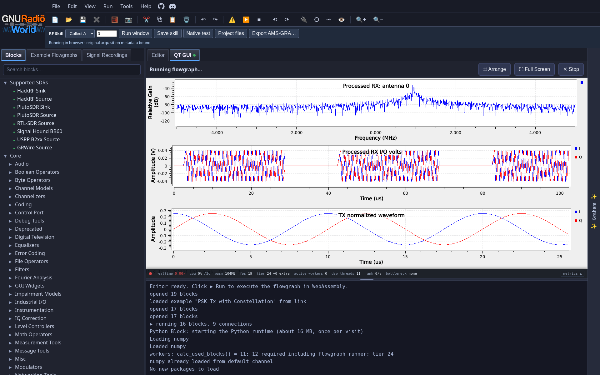
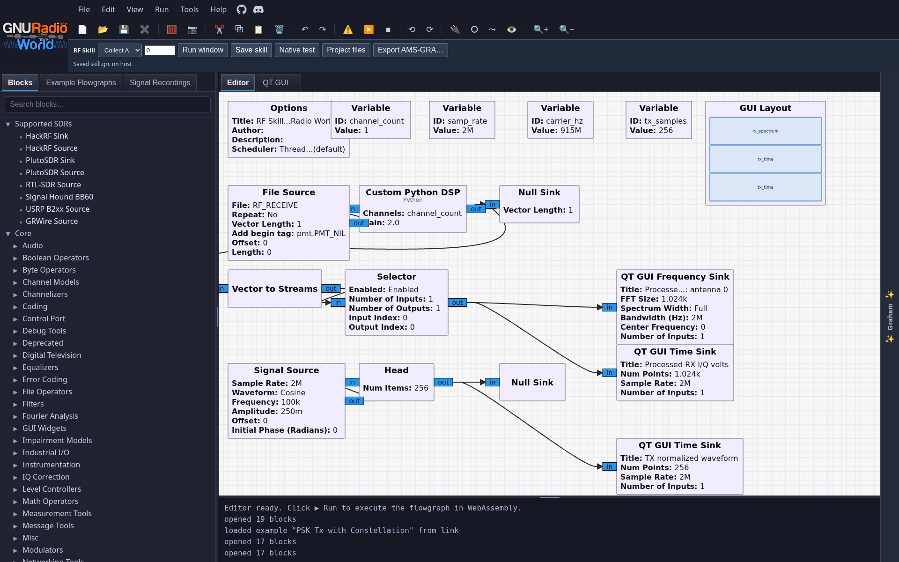
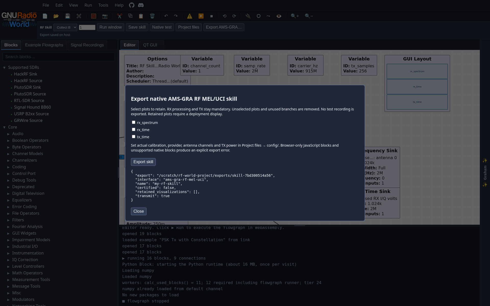
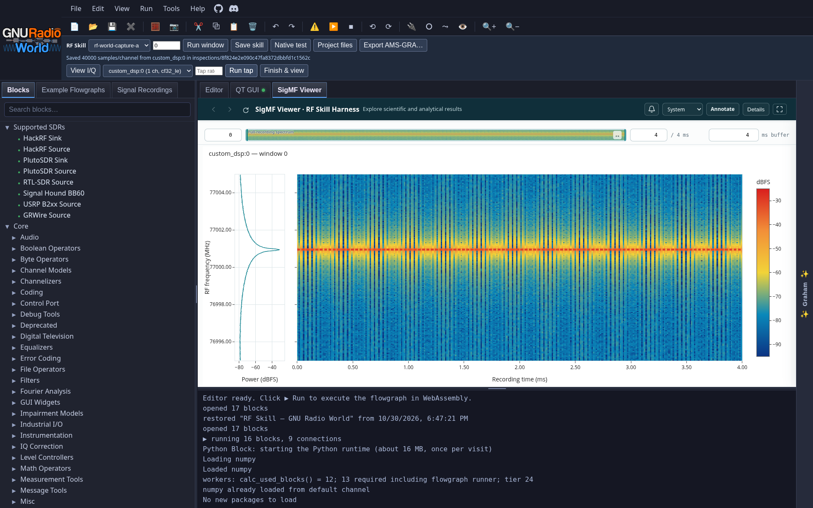
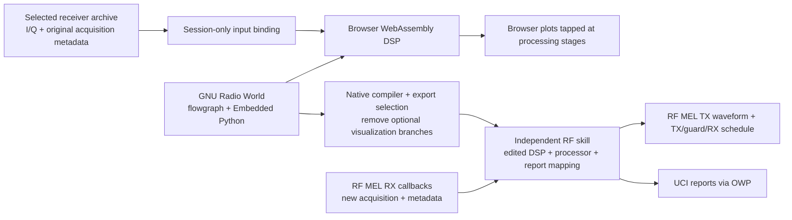

# RF Skill Harness — GNU Radio World

Design and run an RF skill in **[GNU Radio World](https://github.com/777arc/gnuradio-world)**,
using its browser flowgraph editor, Python blocks and WebAssembly DSP. Select
replaceable I/Q collects for development, then export the edited design through
our **native AMS-GRA RF MEL/UCI adapter**.

This is the **main branch**. The browser renders the editor
and plots directly. There is no desktop streaming, VNC, X11 forwarding or host
GNU Radio/Qt installation. The [optional JupyterLab workflow](docs/jupyter-workbench.md) is also available.



<details>
<summary>Editor and native export</summary>





</details>

## Install locally (pip or uv)

The [v0.3.0 release](https://github.com/wa200508/RF-Skill-Harness/releases/tag/v0.3.0)
bundles the built browser editor and WebAssembly/Pyodide runtime:

```bash
python3 -m venv .venv
.venv/bin/python -m pip install \
  https://github.com/wa200508/RF-Skill-Harness/releases/download/v0.3.0/rf_skill_harness-0.3.0-py3-none-any.whl
.venv/bin/rf-world serve --workspace ./my-rf-skill --transmit
```

Open **http://127.0.0.1:8090/**. Add `--recordings /path/to/mission/iq` to select
captures. `rf-world doctor` reports packaged assets and optional native tools.
Pip/uv and a browser support editing, replay and plots. Native testing/export also
needs local GNU Radio; on Ubuntu 24.04 use `sudo apt-get install gnuradio
python3-numpy python3-yaml`. The launcher can use `/usr/bin/python3` for GNU Radio
while the server runs in its own pip/uv environment.

See [native installation](docs/install.md) for uv, a downloadable installer,
interpreter selection, source builds and platform limits.

## Launch with Docker

Requirements: Docker, Python 3.10+, curl, and a recent Chromium or Firefox browser.
From main:

```bash
git switch main
git pull
bash scripts/start_world.sh --workspace "$PWD/my-world-skill" --transmit
```

Open **http://127.0.0.1:8090/** when the launcher reports ready. The script pulls
and verifies `ghcr.io/wa200508/airsim-rf:rf-skill-gnuradio-world`, mounts your project,
and starts the HTTP server. The active Python virtual environment or
`RF_HARNESS_PYTHON` is honored. Rootless Docker is supported. There are no host
X sockets, GPU devices or privileged containers to configure.

Without a checkout:

```bash
curl -fsSL https://raw.githubusercontent.com/wa200508/RF-Skill-Harness/main/scripts/start_world.sh \
  -o start_world.sh
bash start_world.sh --workspace "$PWD/my-world-skill" --transmit
```

Use a **new workspace** for this interface; existing Companion projects are left
intact. `scripts/start_companion.sh` now forwards to this launcher. `--transmit`
adds a TX chain when creating a project; omit it for an RX-only skill.

Add one or several collects:

```bash
bash scripts/start_world.sh --workspace "$PWD/my-world-skill" \
  --recordings /path/to/first/iq --recordings /path/to/another/iq
```

Captures are read-only, and only receiver archives are mounted. Mission truth
stays outside the skill. Save edits with **RF Skill → Save skill**; your project
and **`my-world-skill/exports/`** persist on the host. Reloading reopens the saved
design; it stops the current browser DSP run. Closing the tab leaves the HTTP
server running. Ctrl+C stops/removes the launcher’s container. `--port 8091`
starts another instance. For a remote machine use
`ssh -L 8090:127.0.0.1:8090 user@server`; browser WebAssembly threads require a
secure context such as localhost or HTTPS. The service is bound to host loopback
and is intended for local/SSH access.

For a source build, append `--build --image rf-world:local`. This compiles the
upstream editor with our extension and installs a hash-verified, pinned upstream
WebAssembly runtime. The image serves all DSP/Pyodide files locally; opening the
workbench does not download its runtime from the public World site.

## Design, run, inspect, revise

1. Edit **`skill.grc` on the GNU Radio World canvas**. Insert normal GNU Radio DSP
   between the RF receive File Source and the measurement Null Sink. Those two
   blocks are declared RF endpoints, not files copied into your deployed skill.
   Keep their instance names and the **`RF_RECEIVE`** placeholder.
2. Double-click an **Embedded Python Block**. Edit its Code in the built-in
   browser editor, then use its Python/introspection controls to update ports and
   parameters. NumPy is included; SciPy is available when imported. No external
   text editor is required. The starter has an editable gain block.
3. Tap processing stages with the existing **QT GUI time, spectrum, waterfall,
   constellation, vector or matrix sinks**. World draws them inside the browser.
   Select an antenna before wiring coherent vector streams to scalar sinks.
4. Choose a **test capture and acquisition window** in the RF Skill toolbar, then
   **Run window**. Upstream may ask **Run anyway** because a finite offline window
   deliberately runs without real-time throttling. The **QT GUI** tab displays
   the results. Switch back to **Editor**, revise and rerun.
5. Choose another capture and test the **same skill**. Selection changes a replay
   binding, never the saved design or deployment configuration. Incompatible
   channel counts are rejected rather than quietly dropping antennas.
6. **Project files** edits `processor.py`, `report.py` and deployment `config/`
   directly in the browser. `processor.py` receives a complete processed window
   and returns measurements in the native skill. **Native test** runs that edited
   graph and processor in a fresh process against the selected window, without
   opening desktop plots. Use it to compare browser experiments to deployment.

Browser Python blocks receive **`RF_WINDOW`** and **`RF_CONTEXT`**: acquisition
index, original timestamp, sample offset/count, channel order, sample rate,
carrier, voltage units, receiver/antenna configuration and acquisition/radar
metadata. The native adapter provides the same names. The browser API represents
large nanosecond integers as decimal strings to preserve every bit; block-level
`timestamp_ns` and `first_timestamp_ns` are converted back to Python integers.
Samples remain coherent `[sample, channel]` complex64 volts, interleaved only at
the transport boundary. [Details and limits](docs/gnuradio-world.md).

The screenshot above uses a **synthetic radar protocol fixture**, not a validated
terrain or hardware measurement. Its TX tone is a graph-generated test waveform.

## SigMF Viewer

The **SigMF Viewer** tab adds [Brian Day's viewer](https://github.com/briday1/sigmf-viewer)
alongside GNU Radio World. **View I/Q** opens the selected verified window. Choose
a complex/float output in **Signal inspection tap**, set its actual output rate
when needed, and click **Run tap** to inspect the processed samples. Finite runs
open automatically; **Finish & view** finalizes a running tap.

The original captures stay read-only. Exact SigMF snapshots and metadata persist
under **`my-rf-skill/inspections/<id>/`** and stay outside the exported skill.
[Viewer controls, sample units and code map](docs/sigmf-viewer.md).



## Export an independent RF skill

Configure actual provider, aperture/channel mapping, acquisition parameters,
**volts-per-count calibration** and UCI/OWP identity in `config/`. For TX also
configure supported power, finite waveform length and guards. These settings are
independent of the selected test recording. The initial `report.py` returns no
detections; implement the report mapping for your application.

Click **Export AMS-GRA…**, select any plotting sinks to retain, then **Export
skill**. The default removes plots and unused plot branches. RX measurement and
TX chains stay mandatory. Retained plots require a display on the deployment
machine; leave them unchecked for a headless skill.

The package contains the compiled edited graph, custom Python DSP, declared
source helpers, deployment configuration, native C++ RF MEL/UCI host and Dockerfile.
It excludes recordings, replay bindings, the browser/editor and the harness.
RF MEL callbacks supply new I/Q; the skill has no knowledge of the simulation
or the dataset used while designing it.



The current profile uses independent finite acquisition windows. Native streaming
history resets per window. TX is a finite graph-generated waveform, repeated via
RF MEL with a **nonoverlapping TX → guard → RX → guard schedule**. Adaptive TX,
simultaneous TX/RX and a cross-window streaming-state adapter are future work.
Browser hardware TX support in upstream World is separate from RF MEL deployment.

World and desktop GNU Radio have different supported-block sets and Python
runtimes. Browser-only JavaScript/WebUSB blocks cannot be exported by this
adapter. Missing native blocks and validation failures are reported explicitly.
**Export is not AMS-GRA certification**; qualify against the actual provider,
calibration and UCI schema. See [native interface details](docs/native-export.md).

The generated native skill and the current AirSim dashboard use different live
interfaces: **RF MEL/UCI** and **`receiver-tcp-v2`**, respectively. Recorded I/Q is
a supported test input; a direct live connection requires an adapter and an
end-to-end test. [Compatibility details](docs/install.md#airsim-compatibility-is-a-separate-integration).

## Development and references

- [Install without Docker: pip, uv or installer](docs/install.md)
- [GNU Radio World integration, code map, validation and limitations](docs/gnuradio-world.md)
- [Native AMS-GRA RF MEL/UCI export](docs/native-export.md)
- [I/Q format and replay](docs/metadata.md)
- [Optional JupyterLab workbench](docs/jupyter-workbench.md)
- Upstream [GNU Radio World](https://github.com/777arc/gnuradio-world),
  [Embedded Python support](https://github.com/777arc/gnuradio-world/blob/96e805fb694e3e797b72ebfad30232c732e3f257/docs/embedded-python.md),
  [recording sources](https://github.com/777arc/gnuradio-world/blob/96e805fb694e3e797b72ebfad30232c732e3f257/docs/recording-viewer.md)

Harness/backend source is Apache-2.0. GNU Radio World and the editor extension
are GPL-3.0-or-later; see [license/source notices](world/NOTICE.md).
