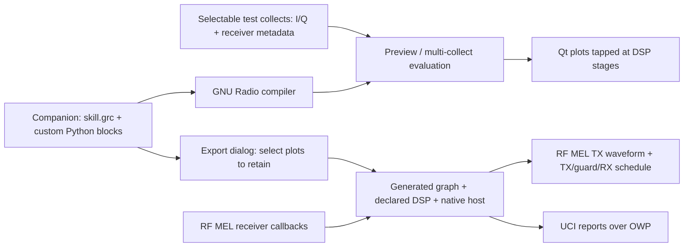

# RF Skill Harness — GNU Radio Companion branch

Develop the skill in **GNU Radio Companion 3.10**, test the same flowgraph against
replaceable I/Q collects, then export it behind the **native AMS-GRA RF MEL/UCI
interface**. This experimental route lives on `feature/gnuradio-companion`;
[main](https://github.com/wa200508/RF-Skill-Harness/tree/main) keeps the
[JupyterLab workbench](docs/jupyter-workbench.md).



## Start Companion

This branch uses the **native Linux desktop** for the editor and Qt plot windows.
The exported skill is containerized. Install GNU Radio through the OS so its
Python bindings, Companion, Qt sinks and scheduler match:

```bash
# Ubuntu 24.04 / Debian with GNU Radio 3.10
sudo apt-get install gnuradio gir1.2-gtk-3.0 python3-gi-cairo python3-venv python3-pip
git clone --branch feature/gnuradio-companion https://github.com/wa200508/RF-Skill-Harness.git
cd RF-Skill-Harness
python3 -m venv --system-site-packages .venv
source .venv/bin/activate
python -m pip install -e .

# No recording required. Include --transmit for a new RX+TX project.
bash scripts/start_companion.sh --workspace "$PWD/my-rf-skill" --transmit
```

The launcher honors the active virtual environment or `RF_HARNESS_PYTHON`.
It opens **stock Companion** and a separate **RF Skill tools panel**. The block
library uses `GRC_BLOCKS_PATH`; there is no patched or forked editor. Restart with
the same workspace to continue. Use a new workspace for this interface; existing
Jupyter projects stay separate. This branch does not yet publish a prebuilt
Companion desktop image.

## Design → test → inspect → revise

1. Edit **`skill.grc` in Companion**. The RF Receive Endpoint supplies simultaneous
   antenna-voltage vectors. Insert standard GNU Radio DSP or custom blocks before
   RF Window Measurements. The starter includes an editable Embedded Python gain.
2. Use **Embedded Python Block → Open in Editor** for custom streaming DSP.
   Companion discovers its ports and parameters. Configure your text editor in
   Companion preferences. Use `processor.py` for complete-window array processing
   and measurement output, and `report.py` for the explicit UCI report mapping.
3. Add **Qt GUI time, frequency, waterfall, constellation, vector or matrix sinks**
   at the stages you want to inspect. Plots are branch taps. The starter shows
   time/spectrum after custom DSP and, for TX projects, the TX waveform. Select an
   antenna before connecting coherent vectors to scalar plot sinks.
4. **Save**, select an external capture and window in the tools panel, then
   **Preview saved graph**. Companion's normal Run action uses the same selected
   capture. Processing runs once; the completed plots remain open until closed.
   Measurements appear in the panel's log.
5. Select a different collect and rerun the **same skill**. No new project, I/Q
   copy or export is needed. Preview compiles the saved graph into temporary files.

For starter data, generate synthetic protocol fixtures and use **Add capture…**:

```bash
rf-harness demo --kind radar --output ./captures/development
rf-harness demo --kind radar --output ./captures/held-out
```

These fixtures test the interface; they are not scene/hardware validation. They
share a deterministic seed; use genuinely different real collects for held-out
validation. The starter graph declares one antenna channel. For an array design,
change `channel_count`, the Embedded Python default vector size, and deployment
channel configuration together. Incompatible channel counts fail explicitly.
Sample rate, carrier, antenna calibration, timestamps and radar-gate metadata
come from each collect. Your algorithm must use them or reject unsupported modes.

Evaluate one saved graph on several complete collects without opening plots:

```bash
python -m rf_skill_harness.companion evaluate ./my-rf-skill \
  --recordings ./captures/development --recordings ./captures/held-out \
  --output ./evaluations/comparison-1
```

The graph is compiled once. Each collect starts fresh and has its own
`results.jsonl`, `context.json` and `run.json`. `evaluation.json` records design
hashes and per-collect timings. The source project is unchanged.

## Export the RF skill

Configure deployment in **`config/`**, independently of test data: RF MEL provider,
stream/channel mapping, calibrated volts per signed integer count, acquisition
settings and OWP identity/topics. Calibration starts unset; export requires an
explicit value. TX also needs provider-supported power, attenuation, guard and
waveform sample count. `report.py` initially reports no detections.

Click **Refresh from saved graph** in the tools panel. Its export list has a
checkbox per active Qt plot. **Unchecked plots and their unused branches are
removed**; RX measurements and TX chains stay mandatory. Check a plot to retain
it, then **Export native AMS-GRA RF skill…** to a new directory. Retained Qt plots
need a deployment display; the default headless export suits an unattended
service. Equivalent CLI:

```bash
python -m rf_skill_harness.companion export ./my-rf-skill --output ./exports/my-rf-skill
# Optional: add --keep-plot rx_spectrum to retain that plot.
cd exports/my-rf-skill
docker build -t my-rf-skill:local .
docker build --target test -t my-rf-skill:test .
```

The package includes the **compiled edited flowgraph**, generated Embedded Python
modules, declared DSP/helper files, sanitized `source/skill.grc`, source hashes,
deployment configuration, native C++ host and Dockerfile. It uses the OS GNU
Radio package. No recording catalog, selected input path, I/Q, experiments,
notebooks, replay reader or harness dependency enters the export. Deployment
obtains new samples from RF MEL at the same DSP boundary used by replay.

The native host loads provider factories, requests a Virtual Aperture and jobs,
receives `ProductRxEndpoint` callbacks, applies calibration and publishes UCI
reports through OWP. **Export is not certification.** Qualify it against your
actual starter-kit provider, hardware calibration and UCI schema.

## Transmit and execution profile

With `--transmit`, standard sources/modulators and custom Python blocks define
TX in the graph. The starter uses a small complex tone. Put **Head(`tx_samples`)
before the TX endpoint and its plot taps** so execution is finite. TX components
are normalized full scale in `[-1, 1]`; RX remains volts. Over-range TX samples
fail instead of being silently clipped.

The native profile generates a **fixed arbitrary waveform** from that branch,
quantizes to ComplexINT16, and repeats it using RF MEL `WaveformBuffer` and
`TransmitEvent`. Each sequence is **TX → guard → RX → guard** with no overlapping
events. The provider must support the waveform modulation, TX/RX groups and power
mode. Changing TX while replaying a recording cannot change its already-recorded
echo; closed-loop validation needs a live simulator or radio provider.

This first profile executes **independent finite windows**. Native streaming
block history resets at each window; RX DSP must preserve sample count, channel
order, volts and acquisition time. Dynamic waveform streaming, feedback-dependent
TX, continuous block history and simultaneous TX/RX need additional adapters.
These capabilities are not claimed here. [Detailed boundaries](docs/companion.md).

## Code, evidence and references

| Location | Purpose |
| --- | --- |
| `src/rf_skill_harness/companion.py` | Creation, GRC validation/code generation, plot pruning, preview/evaluation/export. |
| `src/rf_skill_harness/companion_gui.py` | Capture/window selector and per-plot export dialog. |
| `src/rf_skill_harness/companion_blocks/` | OOT YAML definitions for RF receive, measurements and TX endpoints. |
| `src/rf_skill_harness/companion_runtime.py` | Portable `skill_io.py` acquisition binding and GNU Radio execution. |
| `src/rf_skill_harness/native/` | RF MEL C++ host, calibration, native TX/RX scheduling and UCI/OWP reporting. |
| [Companion findings and validation](docs/companion.md) | Upstream sources, extension choices and tested limits. |
| [Native export guide](docs/native-export.md) | Provider and schema qualification. |
| [Receiver metadata](docs/metadata.md) | Voltage units, channels, acquisition tags and radar gates. |

Validated with actual GNU Radio **3.10.9.2**: custom Python edits reach the exported
DSP; selected plots run and unselected branches disappear; one skill evaluates
multiple collects; export needs no selected I/Q. A native interface fixture also
verified actual TX samples and non-overlapping TX/RX events. The full suite
passed **78 tests**. [Validation scope](docs/companion.md#validation).

Reused upstream features:
[Embedded Python Blocks](https://wiki.gnuradio.org/index.php/Embedded_Python_Block),
[out-of-tree modules](https://wiki.gnuradio.org/index.php/OutOfTreeModules),
[Qt sinks](https://github.com/gnuradio/gnuradio/tree/v3.10.12.0/gr-qtgui/grc),
and the pinned [AMS-GRA RF MEL interface](https://gitlab.com/open-arsenal/ams-gra/hello-world-sk/interfaces/rf-mel/-/tree/a8161fa965b37879e2112533a896f210f721a02a).

Harness source is Apache-2.0. GNU Radio and generated GNU Radio code retain their
upstream GPL obligations; review licensing of a combined distributed skill.
