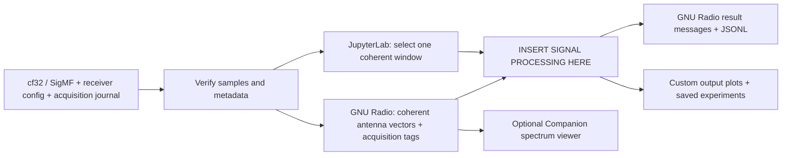

# RF Skill Harness

Develop an RF skill from saved receiver I/Q: **edit Python → run one acquisition
window → visualize outputs → revise** in **JupyterLab**. Use **GNU Radio Companion
3.10** for graphical block development and GNU Radio for repeatable batch replay.
It works on CPU and has no AirSim, Sionna, GPU or detector dependency.



## Which interface fits?

| Interface | Best use here | Fit for the development loop |
| --- | --- | --- |
| **[JupyterLab](https://jupyterlab.readthedocs.io/en/stable/user/notebook.html)** + **[Matplotlib/ipympl](https://matplotlib.org/ipympl/)** | Edit code, select a finite block, inspect arrays, plot custom algorithm outputs, rerun cells. | **Recommended starting point.** A prepared notebook uses the same `processor.py` as batch replay. |
| **[GNU Radio Companion](https://wiki.gnuradio.org/index.php/GNURadioCompanion)** | Connect DSP blocks and standard Qt time, spectrum, waterfall or constellation sinks; write Embedded Python Blocks. | Best when developing a GNU Radio flowgraph or streaming integration. Our prepared viewer initially displays the input spectrum; custom skill results need your own visualization. |
| **[IQEngine](https://github.com/IQEngine/IQEngine)** | Browser-based SigMF spectrogram exploration, annotations and backend DSP plugins. | Useful for browsing/sharing captures. Integrating its plugin backend with our coherent multi-channel acquisition contract is additional work; not part of this harness. |
| **[inspectrum](https://github.com/miek/inspectrum)** | Inspect recorded I/Q visually and measure signal timing, bandwidth and modulation. | Useful input inspection; not the main workspace for editing and plotting an arbitrary RF skill. |

JupyterLab executes the Python hook directly; it does not run the GNU Radio
scheduler. The CLI additionally exercises stream tags, coherent window reassembly
and backpressure. Both use the original receiver data and the same hook contract.

## Use your recorded I/Q

The container launcher needs Linux, Docker and host Python 3.10+. No GPU is needed.

Copy the **whole `iq/` folder** from
`airsim-rf/recordings/dashboard/replays/<run-id>/iq/`. A mission folder containing
`iq/` also works. Data stays on disk; the harness reads it without making another
bulk copy. For a remote simulation host, transfer that folder with your normal
file-copy tool first. Large recordings are not stored in this Git repository.

```bash
git clone https://github.com/wa200508/RF-Skill-Harness.git
cd RF-Skill-Harness

# Pull the CPU container and verify the capture.
bash scripts/run_harness.sh inspect /path/to/iq --verify

# Generate an editable notebook, Python hooks, GNU Radio graphs and RF timeline.
bash scripts/run_harness.sh prepare /path/to/iq --output workspace/my-skill

# Start the browser workspace; no host Jupyter or GNU Radio install is needed.
bash scripts/run_harness.sh lab /path/to/iq --workspace workspace/my-skill
```

Open **http://127.0.0.1:8888/lab**, using the token printed by Jupyter. Open
`analysis.ipynb` and Run All once, then iterate:

1. Set `window_index` and `display_channel` in the processing cell. All coherent
   antenna channels still reach the processor.
2. Open `processor.py` beside the notebook, edit and save your DSP.
3. Rerun the processing cell and the plots. Each call reloads the file's source.
4. Use the standard voltage/FFT/spectrogram plots for input inspection. Edit
   `plot_output.py`, or add notebook cells, for your range–Doppler map, MUSIC
   search, demodulated symbols or other outputs.
5. Run the optional save cell to write JSONL, metadata, source snapshots and PNGs
   into a new `workspace/my-skill/experiments/window-*/` directory.

Use `%matplotlib widget` instead of `%matplotlib inline` for interactive pan/zoom.
Restart the kernel after changing imported helper modules. Single-window calls
start fresh processor state; use sequential replay for algorithms needing warm-up.
The input spectrogram is **not** a radar range–Doppler product: your processor
must interpret chirps and ADC gates using the supplied acquisition metadata.

Changes and saved experiments are ordinary files on the host. **Ctrl+C stops and
removes the lab container**; the workspace remains. Use `--port 8889` if 8888 is
busy. The port is bound to host loopback, including with rootless Docker. For a
remote host, forward it with `ssh -L 8888:127.0.0.1:8888 user@host`.

## Repeatable runs and scripts

After editing, run exactly one original window through GNU Radio:

```bash
bash scripts/run_harness.sh run /path/to/iq \
  --processor "$PWD/workspace/my-skill/processor.py:process_window" \
  --start-window 0 --stop-window 1 \
  --output workspace/my-skill/experiments/batch-1

# Plot saved scalar outputs without running the signal processing again.
bash scripts/run_harness.sh plot workspace/my-skill/experiments/batch-1 \
  --output workspace/my-skill/experiments/batch-1-plots
```

Remove the window bounds to process the whole recording, or select a larger
interval; `stop-window` is exclusive. Use a new output directory for each run.
`plot` writes `results.png`, showing scalar dictionary leaves against original
acquisition time (up to 24 fields). Arrays and image outputs need your custom
plot. The editable `plot_results.py` script is also available in each project for
native Python users. [Direct Python and custom plotting examples](docs/development.md#notebook-and-custom-plotting).

The launcher pulls `ghcr.io/wa200508/airsim-rf:rf-skill-harness`, checks it exists,
mounts input data read-only and runs batch commands offline. The lab publishes
its browser service; its dependencies are already installed in the image.
It supports rootless Docker and
host-owned outputs. Its host Python honors the active virtual environment or
`RF_HARNESS_PYTHON`. GNU Radio runs inside the container with its matching Python.
The image includes GNU Radio, JupyterLab, Matplotlib and ipympl. It is built from
this repository and hosted in airsim-rf's existing public
GHCR package; that hosting location introduces no simulation dependency.
[Public image release workflow](https://github.com/wa200508/airsim-rf/blob/main/.github/workflows/rf-skill-harness.yml).

## Automatic RF acquisition schedule

`prepare` also builds **`timeline.html`** and `schedule.json` from the captured
metadata. Open the HTML directly in your host browser; no container web service
or manually defined schedule is needed. The Companion launcher opens it too.

- **Radar:** recorded receive windows plus configured TX chirps and RX/ADC gates,
  derived from the PRI, chirp duration, gate start/length and chirp origin.
- **ESM/receive-only:** recorded receive/collection windows; no emitter TX
  events are invented from passive I/Q.

Zoom and pan to individual events, or fit the whole capture. Long periodic runs
are stored compactly and aggregate visually when zoomed out. Exact original
timestamps remain available. Configured radar timing is labeled explicitly:
the archive does not record per-window TX enable/disable commands.

This RF acquisition schedule describes when samples were collected. GNU Radio's
separate buffer scheduler runs the DSP with backpressure; it does not redefine
acquisition time. [Timing and metadata details](docs/metadata.md#rf-acquisition-schedule).

## Insert signal processing here

```python
def process_window(iq, metadata, context):
    # iq: read-only complex64 volts, shape [samples, antenna channels]
    # metadata: original acquisition timestamp, sample offset, window, clipping
    # context: ordered channels, rate, carrier, antennas, calibration, radar gates
    return {"your_measurement": ...}  # Return a JSON-compatible dictionary.
```

The supplied hook reports RMS/peak voltage as a starter. Replace it with your
processing, or export a stateful callable. It sees complete coherent acquisition
windows regardless of GNU Radio's scheduler chunk size. [Hook and GNU Radio guide](docs/development.md).

**The samples include whatever the receiver captured.** In the current radar
demo that means target echoes, terrain clutter and receiver noise after ADC
modeling. Replay does not separate components, normalize amplitudes, resample,
regenerate waveforms or change Doppler. Radar samples are dechirped ADC volts;
the SDR scenario uses input-referred complex volts. Zero-filled gate gaps remain.

## Open GNU Radio Companion

Install GNU Radio 3.10 on the host (Ubuntu/Debian: `sudo apt-get install gnuradio`).
After `prepare`, open the editable graph with:

```bash
RF_HARNESS_PYTHON=/usr/bin/python3 \
  bash scripts/open_companion.sh workspace/my-skill/viewer.grc
```

`harness.grc` is the headless processing graph; `viewer.grc` adds an antenna
selector and spectrum. Both use the tagged, coherent source and your processing
hook. Native GNU Radio DSP can be inserted while preserving channel alignment
and tags. The host launcher exposes the package to Companion and its generated
Python; it opens the project from the correct working directory.

## Replay controls and output

`run` defaults to unpaced execution. Add `--speed 1` for sample-clock real-time
pacing, `--speed 2` for twice that rate, or `--start-window 10 --stop-window 30`
for a subset. Wall pacing never changes recorded acquisition time. A slow
processor applies backpressure. There is no total run deadline or implicit loop.
Use `--allow-partial` only for a stable, stopped copy of an interrupted capture.

Every experiment writes a new output directory:

- `context.json`: complete captured receiver configuration and channel order.
- `results.jsonl`: one timestamped result per processed coherent window.
- `run.json`: completion/failure, counts, pacing, elapsed time and GNU Radio version.

Corrupt data and processing errors fail the run; completed results remain.
Existing nonempty output directories are never overwritten.

[Receiver metadata and stream tags](docs/metadata.md) ·
[Native development, tests and container builds](docs/development.md)

For a small synthetic input before transferring a real recording:
`bash scripts/run_harness.sh demo --kind radar --output datasets/demo-radar`.
This tests the archive/processing path; it is not a scene propagation model.

Apache-2.0, aligned with the standalone RF skills. GNU Radio and its packaged
dependencies retain their own licenses.
