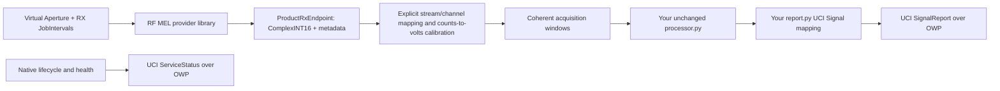

# Native RF MEL/UCI export

The workbench is a development tool. Its output is an independent skill source
distribution containing the declared design, a native host and deployment
configuration. The design is not tied to its test capture. `prepare` still
creates capture-bound GNU Radio graphs for replay; `init` and `lab` create the
independent skill project.

| Implementation | Location |
| --- | --- |
| Project creation without a capture | `src/rf_skill_harness/project.py` |
| Notebook controls and capture switching | `src/rf_skill_harness/workbench.py` |
| Export validation, explicit file packaging and hashes | `src/rf_skill_harness/exporter.py` |
| Native factories, RX scheduling, callback queue and UCI host | `src/rf_skill_harness/native/host.cpp` |
| Voltage calibration, coherent reassembly and DSP invocation | `src/rf_skill_harness/native/engine.py` |
| Developer's UCI result mapping template | `src/rf_skill_harness/report.py` |
| Native fixture qualification | `src/rf_skill_harness/native/qualify_native.py` |

## Native runtime path



The C++ host reuses acquisition/control, dynamic factory loading and UCI/OWP
support from RF FM Demod, pinned at
[`74f9b2d`](https://gitlab.com/open-arsenal/ams-gra/hello-world-sk/skills/rf-fm-demod/-/tree/74f9b2d5b59da44198ea092289a0d487afac10ac).
The FM demodulator and audio output are not invoked. Your Python processor and
reporter are loaded once per deployed process, preserving their state. File
reload belongs to development; deploy a new export to update production code.

`native/dependencies.json` pins RF MEL, common MEL, AMS Math, AMS VITA and the
reference implementation by full Git SHA. The build verifies each checkout and
retains upstream license/notice/intent files. The provider binary is a deployment
input, not an automatically selected implementation.

The native bridge always requires NumPy. Declare additional DSP dependencies
explicitly in skill.json; the exported runtime and native qualification target
install that same requirement set rather than inheriting the workbench's tools.

The shared processor inputs are complex64 volts in `[sample, channel]` order,
acquisition time/offset/window metadata and receiver configuration. A recording's
archive manifest is diagnostic context, not a portable hardware API; native
skills must not depend on recording-only fields. The native adapter adds MEL
provenance and marks unavailable clipping estimates explicitly.

The exported build applies one recorded patch to the pinned OWP client: an idle
PositionReport subscription has no mission deadline, and shutdown explicitly
cancels its pending read. Connection and publication transactions retain finite
timeouts. Native qualification keeps that subscription silent beyond the
transaction timeout and requires continued service health and clean shutdown.

## Acquisition semantics

- The native format is `MELComplex<int16_t>` through the RF MEL callback, not
  our receiver-TCP-v2 protocol or bare UDP.
- Each callback must identify exactly one configured receive stream ID.
  Map those IDs to ordered antennas explicitly. Multiple antennas are joined
  only at equal acquisition epochs; ambiguous packed layouts are rejected.
- Input counts are multiplied by the configured positive volts-per-count
  calibration. `/32768` is not assumed to mean volts. Receiver-array phase/gain
  calibration remains available in receiver configuration to the DSP.
- Receive-event metadata must account for every sample, with matching rate and
  carrier. Event durations must imply integral sample counts. Gaps, overlaps,
  missing channels and bounded-queue overruns fail instead of dropping data.
- Native UTC acquisition time comes from `ProductRxMetadata`, never callback
  arrival time. Window `timestamp_ns` floors to nanoseconds; the exact rational
  femtosecond timestamp is retained separately. No floating epoch conversion is
  used. Receive-event and native job metadata accompany the window.
- MEL does not supply our ADC clipping estimate. The exported adapter reports
  `null` for that estimate and declares it unavailable; it does not invent zero
  clipping. Processors must handle that availability difference deliberately.
- Processing windows are explicit `window_samples`, independent of callback
  sizes. `receive_event_samples` determines requested receive-event duration.
  Native callbacks are bounded to 65,536 complex samples by this profile.

The first export profile schedules **receive** jobs only. Receiving already
dechirped radar data can exercise radar DSP, but commanding active radar TX,
waveform streaming and synchronized TX/RX jobs requires a transmit-capable
profile. Export rejects an unsupported transmit capability rather than silently
emitting a receiver-only package.

## Output semantics

`report.py:signal_reports(measurements, metadata, context)` returns a list of UCI
Signal dictionaries. An empty list means no reportable detection. The host adds
SignalReport headers and per-signal identities, preserves the acquisition
timestamp and publishes through the reference OWP client. Report publication is
rate-limited separately from processing. The receiver data is still processed
when publication is throttled.

The default mapping emits nothing: RMS voltage is not automatically a detection.
Define thresholds and domain-specific UCI fields explicitly. Fields must conform
to the UCI schema deployed by your OWP service. No automatic mapping can infer
whether an arbitrary array represents a bearing, range, track or spectrum.

ServiceStatus uses the starter-kit INITIALIZING/NORMAL/DEGRADED lifecycle.
Acquisition/processor failures exit nonzero after a best-effort DEGRADED status;
an external supervisor can restart a failed service. There is no simulation
truth dependency or recording reader in the production runtime.

## Build, deploy and qualify

Export from the notebook or run `rf-harness export PROJECT --output NEW_DIRECTORY`.
The host container launcher exposes the same `export` command. Build the generated
Dockerfile, stage a provider library compatible with the runtime C++/glibc ABI,
set provider configuration and authorized OWP endpoints, then run on the starter
kit network. The generated README contains the command and configuration paths.
The workbench does not provision or modify an AMS-GRA deployment automatically.

Export manifests explicitly distinguish generated source from validated
deployment. A fixture test can verify native factories, RX jobs, callbacks,
coherent processing, UCI envelopes, OWP sessions, and lifecycle. It cannot prove
provider/hardware interoperability or complete UCI/OMS compliance. Run the
exported service with your deployed provider and validate its emitted messages
against your actual UCI schema before making that claim.

To run the generated source package against the pinned native fixtures:

```bash
docker build --target native-test --build-arg BUILD_NATIVE_FIXTURE=ON \
  -t my-rf-skill:native-test .
docker run --rm --network none my-rf-skill:native-test
```

This fixture delivers two complete windows of signed-integer test samples, checks
acquisition timestamps and journaling, and observes native OWP lifecycle traffic.
Add `--expect-signal` only when your declared design should report a detection
on that fixture input. CI uses an explicitly synthetic eight-antenna design to
check signal publication, calibrated sample values and every channel's metadata.
`docker build --target test .` separately runs the exported Python window-contract
test on zero input without a live provider. These checks do not replace the
deployed-provider and full-schema gates.

Static import checks reject obvious harness/simulator imports in declared Python
files. They are portability checks, not an adversarial sandbox or proof about
dynamically constructed imports. The explicit file allowlist prevents accidental
capture/notebook inclusion; it does not infer licensing or the meaning of custom
model assets. Declare additional files/dependencies intentionally.

Upstream references:

- [RF FM Demod external contracts](https://gitlab.com/open-arsenal/ams-gra/hello-world-sk/skills/rf-fm-demod/-/blob/74f9b2d5b59da44198ea092289a0d487afac10ac/docs/contracts.md)
- [RF MEL interfaces](https://gitlab.com/open-arsenal/ams-gra/hello-world-sk/interfaces/rf-mel)
- [Reference OMS self-assessment](https://gitlab.com/open-arsenal/ams-gra/hello-world-sk/skills/rf-fm-demod/-/blob/74f9b2d5b59da44198ea092289a0d487afac10ac/docs/compliance/oms-service-checklist.md)
